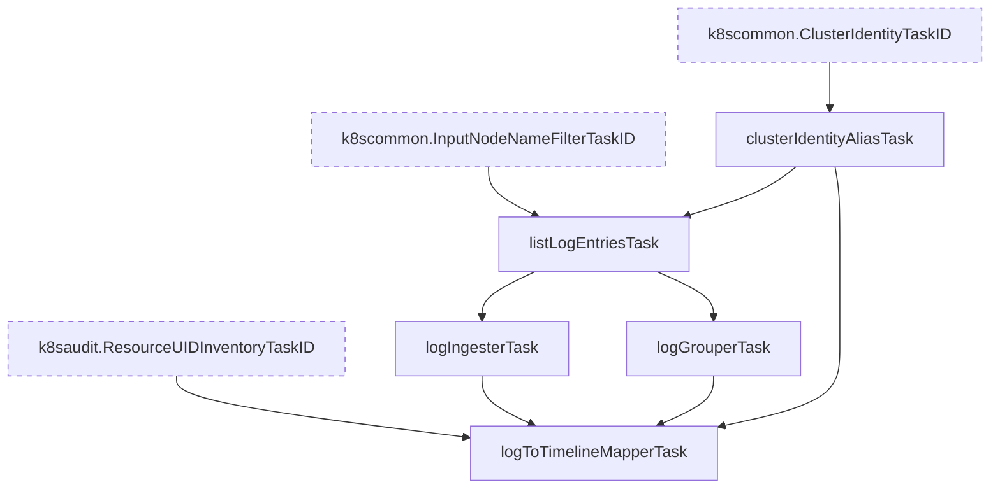

# Dataplane V2 Network Policy Log Inspection Tasks

This package (`googlecloud/dpv2policy`) contains the tasks that parse GKE Dataplane V2 network policy logs and map them to timelines.
These logs are written to Cloud Logging as the `policy-action` log of the `k8s_node` resource type.
Each log records one connection (or a group of denied connections) that network policies allowed or denied.

## Prerequisites

The Cilium agent (`anetd`) writes network policy logs only when network policy logging is enabled for the cluster with the `NetworkLogging` resource (`allow.log` or `deny.log` is `true`).
Each node can write up to 500 logs per second, so the log volume can be large in clusters with heavy traffic.

The `googlecloud/k8snode` package excludes `policy-action` logs from its query, so these logs are only gathered when this feature is enabled.

## Task Graph

## Task Descriptions

- **`clusterIdentityAliasTask`**: Provides the cluster identity from the shared `k8scommon.ClusterIdentityTaskID` task.
- **`listLogEntriesTask`**: Queries `resource.type="k8s_node"` and `LOG_ID("policy-action")` from Cloud Logging. The node name filter shared with the other node logs also applies to this query.
- **`logIngesterTask`**: Sets the log type, the timestamp, the severity, and the summary of each log. Denied connections use the `WARNING` severity so that they stand out on timelines. The summary looks like `[DENY x6] ingress TCP default/sleep:53538 -> default/httpbin:8080 (implicit deny)`.
- **`logGrouperTask`**: Groups logs by the node that reported them, so that the logs of each node are mapped in parallel.
- **`logToTimelineMapperTask`**: Adds an event for each log to the related timelines. This is the feature task shown as "Dataplane V2 Network Policy Logs".

## Timeline Mapping

The mapper adds an event of each log to the following timelines.

| Timeline | Condition |
| --- | --- |
| The `outbound` timeline (type `netpol`) under the source Pod | The source of the connection is a Pod. |
| The `inbound` timeline (type `netpol`) under the destination Pod | The destination of the connection is a Pod. |
| The timeline of the network policy resource | A policy rule is derived from a `NetworkPolicy`, an `FQDNNetworkPolicy`, or a `ClusterNetworkPolicy`. |
| The `policy-action` timeline (type `netpol`) under the reporting Node | Neither the source nor the destination is a Pod. |

Notes:

- Cilium records the workload fields only for Pods on the reporting node. Pods are identified only by their namespace and name, so Pods on remote nodes are also linked.
- When both the source and the destination have policies, a connection produces two logs: an `egress` log from the source node and an `ingress` log from the destination node. Both logs appear on the timelines of both Pods.
- Reserved rules (for example, `reserved:allow-localhost-ingress`) are added by Cilium without Kubernetes resources. They are shown in the summary but are not linked to any resource timeline.
- Cilium can list the same rule more than once in a log. The summary shows each rule only once.

## Policy Resource Resolution

The mapper resolves the network policy resource of each policy rule as follows.

1. When the UID in the `k8s:io.cilium.k8s.policy.uid` label is found in the resources recorded by Kubernetes audit logs, the mapper uses that resource. This uses the API version that the cluster actually serves. The resource list is empty when the Kubernetes Audit Logs feature is not enabled.
2. Otherwise, the mapper uses the following API versions.

| Kind | API version and kind on timelines | Scope |
| --- | --- | --- |
| `NetworkPolicy` | `networking.k8s.io/v1` `networkpolicy` | Namespaced |
| `FQDNNetworkPolicy` | `networking.gke.io/v1alpha1` `fqdnnetworkpolicy` | Namespaced |
| `ClusterNetworkPolicy` | `policy.networking.k8s.io/v1alpha2` `clusternetworkpolicy` | Cluster |
