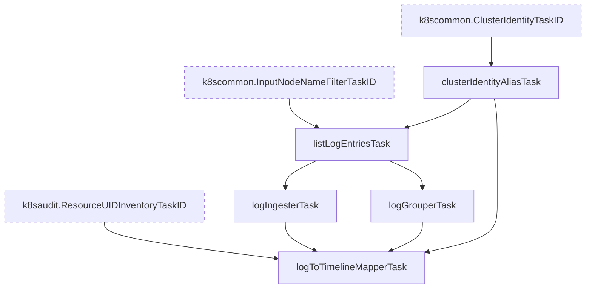

# Dataplane V2 ネットワークポリシーログ インスペクションタスク

`googlecloud/dpv2policy` パッケージは、GKE Dataplane V2 のネットワークポリシーログを解析し、タイムラインに紐付けるタスク群を提供します。
このログは `k8s_node` リソースタイプの `policy-action` ログとして Cloud Logging に書き込まれます。
各ログは、ネットワークポリシーによって許可または拒否された 1 つの接続（または集約された拒否接続）を記録します。

## 前提条件

Cilium エージェント（`anetd`）は、`NetworkLogging` リソースでクラスタのネットワークポリシーロギングが有効（`allow.log` または `deny.log` が `true`）な場合にのみネットワークポリシーログを書き込みます。
各ノードは最大で毎秒 500 件のログを書き込めるため、通信量の多いクラスタではログ量が大きくなることがあります。

`googlecloud/k8snode` パッケージはクエリから `policy-action` ログを除外しているため、このログは本機能を有効にした場合にのみ収集されます。

## タスクグラフ

## タスクの説明

- **`clusterIdentityAliasTask`**: 共通の `k8scommon.ClusterIdentityTaskID` タスクからクラスタ識別情報を提供します。
- **`listLogEntriesTask`**: Cloud Logging から `resource.type="k8s_node"` かつ `LOG_ID("policy-action")` のログを取得します。他のノードログと共通のノード名フィルタもこのクエリに適用されます。
- **`logIngesterTask`**: 各ログのログタイプ、タイムスタンプ、Severity、サマリを設定します。拒否された接続はタイムライン上で目立つように `WARNING` Severity になります。サマリは `[DENY x6] ingress TCP default/sleep:53538 -> default/httpbin:8080 (implicit deny)` のような形式です。
- **`logGrouperTask`**: ログを出力したノードごとにグループ化し、ノード単位で並列にマッピングできるようにします。
- **`logToTimelineMapperTask`**: 各ログのイベントを関連するタイムラインに追加します。「Dataplane V2 Network Policy Logs」として表示される機能タスクです。

## タイムラインへの紐付け

マッパーは各ログのイベントを次のタイムラインに追加します。

| タイムライン | 条件 |
| --- | --- |
| 送信元 Pod 配下の `outbound` タイムライン（タイプ `netpol`） | 接続の送信元が Pod である。 |
| 宛先 Pod 配下の `inbound` タイムライン（タイプ `netpol`） | 接続の宛先が Pod である。 |
| ネットワークポリシーリソースのタイムライン | ポリシールールが `NetworkPolicy`、`FQDNNetworkPolicy`、`ClusterNetworkPolicy` のいずれかに由来する。 |
| ログを出力したノード配下の `policy-action` タイムライン（タイプ `netpol`） | 送信元と宛先のどちらも Pod ではない。 |

補足:

- Cilium は、ログを出力したノード上の Pod にのみ workload フィールドを記録します。Pod は Namespace と名前だけで識別するため、別ノード上の Pod も紐付けられます。
- 送信元と宛先の両方にポリシーがある場合、1 つの接続から送信元ノードの `egress` ログと宛先ノードの `ingress` ログの 2 件が出力されます。どちらのログも両方の Pod のタイムラインに表示されます。
- 予約ルール（例: `reserved:allow-localhost-ingress`）は Kubernetes リソースを持たず Cilium が追加するルールです。サマリには表示しますが、リソースのタイムラインには紐付けません。
- Cilium は 1 件のログに同じルールを複数回記録することがあります。サマリには各ルールを 1 回だけ表示します。

## ポリシーリソースの解決

マッパーは各ポリシールールに対応するネットワークポリシーリソースを次の順に解決します。

1. `k8s:io.cilium.k8s.policy.uid` ラベルの UID が Kubernetes 監査ログに記録されたリソースに見つかった場合は、そのリソースを使います。これにより、クラスタが実際に提供している API バージョンが使われます。Kubernetes Audit Logs 機能が有効でない場合、このリソース一覧は空です。
2. それ以外の場合は、次の API バージョンを使います。

| Kind | タイムライン上の API バージョンと kind | スコープ |
| --- | --- | --- |
| `NetworkPolicy` | `networking.k8s.io/v1` `networkpolicy` | Namespace |
| `FQDNNetworkPolicy` | `networking.gke.io/v1alpha1` `fqdnnetworkpolicy` | Namespace |
| `ClusterNetworkPolicy` | `policy.networking.k8s.io/v1alpha2` `clusternetworkpolicy` | クラスタ |
